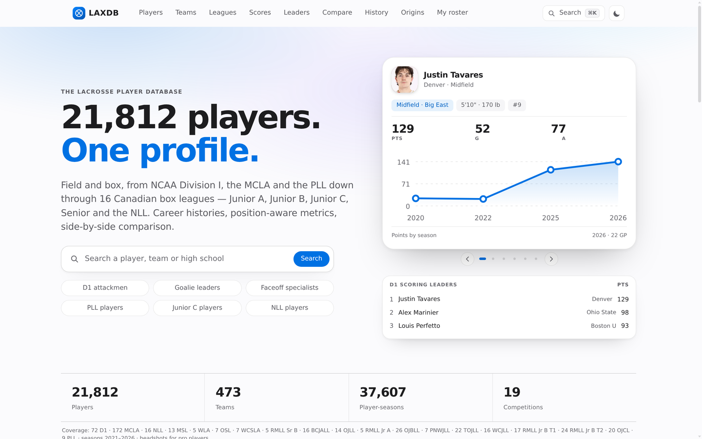
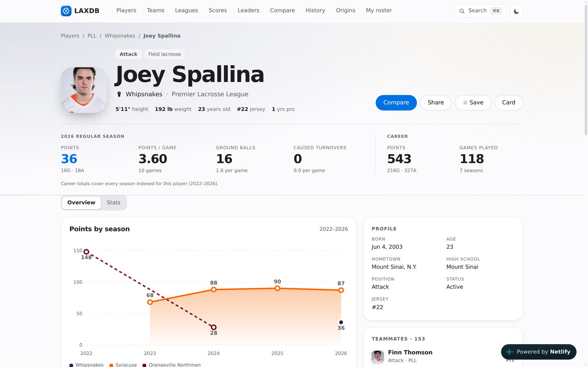
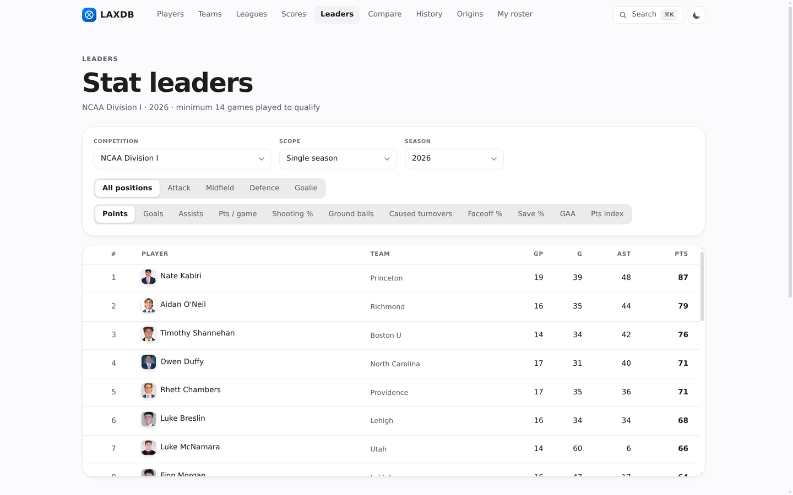
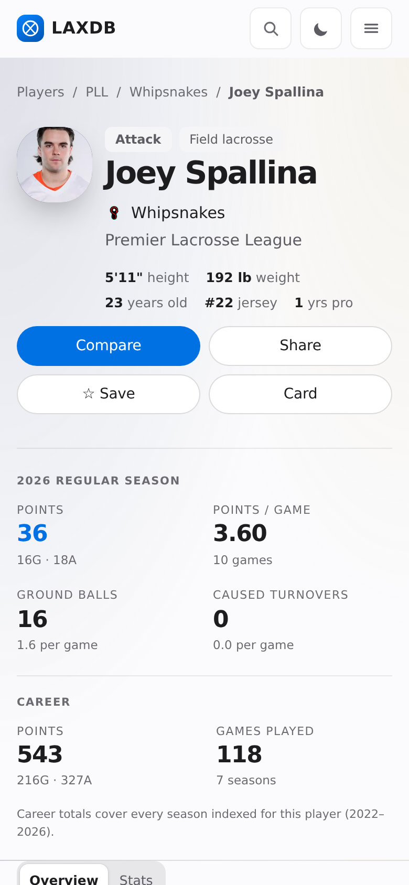

# LAXDB

**The lacrosse player database.** 21,812 players, one profile each.

**[laxdb.netlify.app](https://laxdb.netlify.app)**



Lacrosse has no reference site the way hockey has Elite Prospects. A college player's stats live on a
school athletics page, his summer box season lives on a league stats site running different software, his
pro career lives in a league API, and the record book — national champions, Tewaaraton winners,
All-Americans — lives in PDFs and Wikipedia tables. Nothing joins them, so a question like "where did this
guy come from, and what has he actually done" turns into six tabs.

LAXDB answers it on one page. Each player gets a single merged career across college field, pro field
and the Canadian box pyramid — from Junior C all the way to the NLL — with season-by-season stats in the
columns his league actually publishes, a game log where box scores exist, and the record-book context
around him. Everything from real, published feeds. No invented names, no synthetic stat lines, and when a
source doesn't publish something the site hides the field or labels the gap instead of guessing.

It borrows that product shape — bio card, career table, game log, comparables — and none of the look:
quiet, Apple-inspired, data first rather than table-dense.

## What you can look up

**A player** — `#/player/joey-spallina`
Bio card with vitals, draft/class, handedness where a source publishes it; career totals; season by
season across every team and league he has appeared for; position-aware stat columns (field skaters get
SH%, GB, TO, CT, FO%; goalies get MIN, GA, GAA, SV, SV%; box players get PIM, because that is what box
feeds publish); a game log built from official box scores with last-5 form, point streaks, single-game
highs, splits by month and result, and opponent-adjusted scoring; teammates ranked by career points;
comparable players via a 1–99 similarity score z-scored inside his position group; and a peer rank
("2nd of 37 attackmen in points per game"). CSV export and a 1200×630 share card sit on every profile.



**A team** — `#/teams`, `#/team/:slug`
Roster and stat leaders, record and conference standing, Elo rating with strength of schedule, recent
seasons rebuilt from last year's results, returning production (the share of last season's points from
players who are back, with departures named), coaching staff, season stat summary, and the high schools
that feed the program.

**A competition** — `#/leagues`, `#/league/:id`
Standings (derived from results for D1, published for MCLA and the PLL), a conference breakdown ordered
by Elo, three D1 polls with movement arrows, sortable leaderboards, goalie leaders, and the league's
teams.

**The record book** — `#/history`
126 seasons of national champions, titles by program, every Tewaaraton winner, NCAA record-book boards,
and USILA All-America teams 2023–2026 — parsed out of Wikipedia and the association's own PDFs, with
note rows ("No Awards Due to COVID-19") filtered rather than counted as winners.

**Across the sport**
`#/leaders` ranks every category, single season or career, with the qualification minimum printed on the
page so a two-game sample cannot top a board, plus a points index (100 = that competition's average
player-game) that lets a Junior C scorer be compared with a Division I one. `#/origins` maps where D1
players come from, by headcount, share and players per 100,000 residents, with the programs each state
feeds most. `#/scores` is the season day by day; `#/vs/:a/:b` is the head-to-head record between two
programs and every meeting in the feed; `#/game/:date/:home/:away` reassembles one game from both sides'
player logs.



**Comparing** — `#/compare` puts up to three players side by side with row-scaled bars, and the compare
tray persists in `localStorage` so the selection follows you between pages. **My roster** keeps players
in the browser with no account. A ⌘K / Ctrl+K palette reaches every route, and filters, comparisons and
tables all mirror into the URL, so every view is a shareable link.

<p align="center">
  
</p>

The phone layout is a first-class target, not a squeezed desktop: tables become labelled block lists
rather than sideways scrollers, the nav collapses into a menu sheet, and every route is measured for
horizontal overflow at 360 and 390px.

## One person, one profile

Merging careers is the hard part, and it is deliberately conservative. 2,032 players appear on more than
one team and 1,540 in more than one competition, so the same person routinely shows up in feeds that
share no id. Names collide too often to be evidence — there are two "Aidan Smith"s at two MCLA schools in
the same season — so identity is decided in order:

1. **An equal date of birth decides it either way.** Two rows with one DOB are one person, however far
   apart the leagues; two different DOBs never merge.
2. **Same season on the same club means two people**, no matter how alike the names.
3. **Club or documented alias** across a rename (Brooklin → Brooklin L.C., Elora Mohawks → Elora Hawks),
   with a year-gap ladder for junior-to-senior and NCAA-to-pro movement.
4. **Position compatibility and league type** guard the rest — a goalie never merges with an attacker.

When evidence runs out the profiles stay separate, and the interface says the career total covers only
the seasons indexed. The full policy and the duplicate repairs it forced are in `docs/roadmap.md`.

## The data

**21,812 players · 473 teams · 19 competitions · 37,607 player-seasons · seasons 2020–2026.** All of it
scraped from public sources; the importer caches every response, so a rebuild costs seconds.

| Competition | Level | Teams | Players | Seasons |
| --- | --- | ---: | ---: | --- |
| NCAA Division I | college, field | 72 | 7,142 | 2022–2026 |
| MCLA | college club, field | 172 | 8,301 | 2025–2026 |
| Premier Lacrosse League | professional, field | 9 | 420 | 2021–2026 |
| NLL + 15 Canadian box leagues | pro → Junior C, box | 220 | 5,949 | 2020–2026 |

The box pyramid runs all the way down: NLL, Major Series Lacrosse, WLA, OSL, WCSLA, RMLL Senior B,
BCJALL, OJLL, RMLL Junior A, OJBLL, PNWJLL, TOJLL, WCJLL, RMLL Junior B Tier I and Tier II, and Ontario
Junior C — the level where most Canadian players actually start.

Around the dataset: **3,046 players carry a game log** (28,845 games), **1,146 D1 finals and 101 PLL
games** in the scores feed, 126 championship seasons, and 409 All-Americans across four years.

| Source | What it gives |
| --- | --- |
| School athletics sites (Sidearm), 72 D1 programs | cumulative season stats, rosters, coaches, headshots |
| NCAA.com individual statistics | the goalie table the school pages omit |
| mcla.us | 172 club teams, per-team skater and goalie tables, conference standings |
| stats.netfrontsports.com | the Canadian box pyramid, season by season, plus career aggregates |
| stats.premierlacrosseleague.com | PLL players, per-season lines, headshots, standings |
| ESPN scoreboard + the PLL games API | D1 and PLL finals, which feed standings and Elo |
| ncaa.com, usila.org | committee top 10, full RPI, coaches poll |
| GameSheet | box-league bios, photos, club logos and handedness |
| Wikipedia | champions, titles by program, Tewaaraton, `shoots` handedness, birth dates |

**Assets:** 6,127 player headshots (every PLL player, most current D1 rosters, and the box clubs whose
league pages carry photos) and 344 team marks, all square-cropped and normalised to webp.

### What it does not have

Stated plainly, because the site states it plainly too:

- **NCAA D2, D3, prep and international lacrosse are not covered.** Those tiers are represented by MCLA
  and the Canadian box pyramid, not by D2/D3 field programs. `docs/deferred-sources.md` explains why.
- **Bios are uneven.** 12,718 profiles have no photo, birth date, height or weight — mostly MCLA, whose
  source publishes nothing beyond name, position and class, and the smaller box leagues. Coverage is
  trended in `docs/coverage-history.json` and planned in `docs/data-gaps.md`.
- **No official standings for box leagues.** NetFront publishes none, so box league pages show rosters
  and leaderboards rather than a table nobody maintains.
- **Career totals mean the indexed span**, 2020/2021 onward, not a full career. The profile says so
  under the stat strip.
- **Box feeds publish rates, not minutes or saves**, so GAA and SV% are the printed values rather than
  recomputed ones.
- **Handedness exists for 771 players** — Wikipedia infoboxes and league roster pages — so it shows on
  the profile and the compare view, not as a filter.
- **Some players are still two profiles.** When no source publishes a shared identifier, a merge would
  be a guess, and a guess is worse than a gap.

## Design

One accent (`#0071e3` / `#0a84ff`), a system type stack, hairline borders, frosted chrome, 20–26px radii,
one elevation level per surface, tabular numerals, and motion in 120/200/320/560ms steps that honours
`prefers-reduced-motion`. Team colours appear only as identity washes and crest badges, and they are
lifted for the dark theme rather than mixed toward white, which would desaturate a navy series into grey.

The whole design system is hand-written CSS: `src/styles.css` holds the tokens and `[data-theme="dark"]`,
`src/components/ui.tsx` holds the primitives, and there is no component library. The spec — colours, type
scale, shadow vocabulary, component definitions, breakpoints — is `DESIGN.md` and `PRODUCT.md`, and the
reasoning behind what was borrowed from where is `docs/design-notes.md`.

## How it is built

A static, hash-routed Vite + React + TypeScript single-page app. `public/data.json` (18 MB, ~1 MB
brotli) is fetched once at boot behind skeleton loaders; game logs ship separately in `games.json` and
load the first time a log is opened, so the rest of the site is not paying for them. Every rate
(PTS/G, SH%, SV%, GAA, FO%) is computed at render time from stored raw counts, so a total can never
disagree with the table beside it.

The data side is Python. Importers read each provider, cache the raw HTML, and write one normalised
document; separate passes top up logos, headshots, history, polls, scores, handedness and box positions.
Field coverage per provider — what each source actually publishes, and where the holes are — is
`docs/providers.md`; `scripts/coverage.py` prints the live percentages.

There is also a **CMS in progress**: an in-place editor behind admin auth that writes an override layer
keyed by entity id rather than editing `data.json`, so a re-import can never cost a correction
(`docs/cms.md`).

## Development

```bash
npm install
npm run dev          # http://localhost:5173
npm run build        # tsc + vite build → dist/
npm run preview      # serve the build on :4173
npm run typecheck    # type check without emitting
```

The build is fully static — drop `dist/` on any host. It is deployed to Netlify from `main`; a manual
deploy is `python3 scripts/deploy-netlify.py`.

Rebuilding the dataset:

```bash
./scripts/rebuild-all.sh                  # import → logos → headshots → history → polls → scores → build → deploy
python3 scripts/fetch-real-data.py        # import alone, from scripts/.cache/
python3 scripts/fetch-real-data.py --refresh
python3 scripts/coverage.py --save        # per-league field coverage snapshot
```

Run the passes in that order: a bare re-import rebuilds `data.json` from the feeds and resets the asset
fields, so logos and headshots fall back to whatever the in-import parsers can find.

## Documentation

| File | What is in it |
| --- | --- |
| `PRODUCT.md` | who the site is for, what it is trying to be, the principles it holds to |
| `DESIGN.md` | design tokens, components, breakpoints |
| `docs/roadmap.md` | what shipped, what is next, and the merge policy |
| `docs/providers.md` | which source gives which field, per league |
| `docs/data-gaps.md` | the phased plan to close the bio gaps, with measured yield |
| `docs/coverage-history.json` | coverage trend, one snapshot per pass |
| `docs/deferred-sources.md` | sources deliberately skipped, and what was tried |
| `docs/competitive-scan.md` | 13 reference sites checked in a browser, 38 features logged |
| `docs/cms.md` | the admin editor: plan, field registry, auth model, phases |
| `CHANGELOG.md` | dated, in prose |

## Status

A personal project, live and being built out in public. The sport is covered end to end — college,
pro field and Canadian box — and the work now is depth: a photo, a birth date and a hometown on the
profiles that still have none, NCAA D2/D3, and finishing the admin editor. What shipped and what is next
is in `docs/roadmap.md`; `CHANGELOG.md` has the dated prose version.
